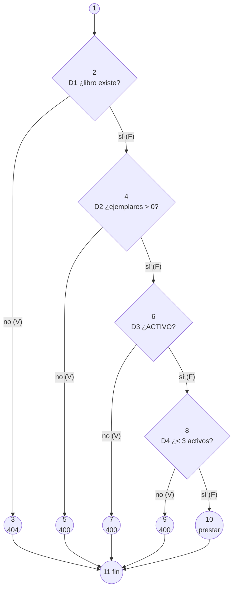
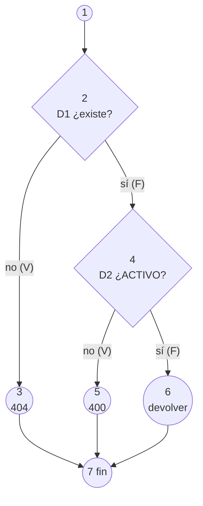

# Método del camino básico · BiblioTech

Pruebas: `backend/src/test/java/pe/edu/upeu/bibliotech/unitarias/CaminoBasico*Test.java`

Fórmulas usadas (Sesión 2):

- V(G) = A − N + 2 (aristas − nodos + 2)
- V(G) = P + 1 (nodos predicado + 1)
- V(G) = número de regiones del grafo

---

## 1. `registrarPrestamo(estudianteId, libroId)` (RN-03)

### Código con los nodos numerados

```java
public Prestamo registrarPrestamo(Long estudianteId, Long libroId) {
    Libro libro = libroRepository.findById(libroId).orElse(null);            // 1
    if (libro == null) {                                                     // 2  (D1)
        throw new RecursoNoEncontradoException("El libro no existe");         // 3
    }
    if (libro.getEjemplaresDisponibles() <= 0) {                             // 4  (D2)
        throw new ReglaNegocioException("El libro no tiene ejemplares...");   // 5
    }
    Estudiante estudiante = buscarEstudiante(estudianteId);                  // 6
    if (estudiante.getEstado() != EstadoEstudiante.ACTIVO) {                 // 6  (D3)
        throw new ReglaNegocioException("El estudiante no está ACTIVO");      // 7
    }
    long activos = prestamoRepository.countByEstudianteIdAndEstado(...);     // 8
    if (activos >= MAXIMO_PRESTAMOS_ACTIVOS) {                               // 8  (D4)
        throw new ReglaNegocioException("...ya tiene 3 préstamos activos");   // 9
    }
    libro.prestarEjemplar();                                                 // 10
    libroRepository.save(libro);                                             // 10
    return prestamoRepository.save(new Prestamo(estudiante, libro));         // 10
}                                                                            // 11 (fin)
```

> `buscarEstudiante()` es un método auxiliar privado (V(G) = 2: estudiante existe / no existe → 404).
> Se analiza aparte para que `registrarPrestamo()` conserve exactamente las cuatro decisiones D1–D4
> que pide el enunciado. Su caso «no existe» lo cubre `PrestamoServiceTest.registrarPrestamo_estudianteInexistente`.

### Grafo de flujo



(«V» significa que se cumple la condición del `if`, es decir, que se rechaza.)

### Complejidad ciclomática

| Fórmula | Cálculo | V(G) |
|---|---|---|
| A − N + 2 | 14 aristas − 11 nodos + 2 | **5** |
| P + 1 | 4 nodos predicado (2, 4, 6, 8) + 1 | **5** |
| Regiones | 4 regiones cerradas + 1 exterior | **5** |

Aristas: 1-2, 2-3, 2-4, 4-5, 4-6, 6-7, 6-8, 8-9, 8-10, 3-11, 5-11, 7-11, 9-11, 10-11 (14).

### Caminos independientes y casos de prueba

| Camino | Recorrido | Datos de entrada | Resultado esperado | Prueba JUnit |
|---|---|---|---|---|
| C1 | 1-2-3-11 | libroId inexistente | 404 «El libro no existe» | `camino1_libroNoExiste` |
| C2 | 1-2-4-5-11 | libro con 0 ejemplares | 400 «no tiene ejemplares disponibles» | `camino2_sinEjemplares` |
| C3 | 1-2-4-6-7-11 | libro con 2 ejemplares, estudiante INACTIVO | 400 «no está ACTIVO» | `camino3_estudianteInactivo` |
| C4 | 1-2-4-6-8-9-11 | estudiante ACTIVO con 3 préstamos activos | 400 «ya tiene 3 préstamos activos» | `camino4_limiteDePrestamos` |
| C5 | 1-2-4-6-8-10-11 | estudiante ACTIVO con 2 préstamos (borde), libro con 2 ejemplares | préstamo ACTIVO, el libro queda con 1 ejemplar | `camino5_prestamoExitoso` |

---

## 2. `devolverLibro(prestamoId)` (RN-04)

Decisiones identificadas a partir de la regla «El préstamo debe existir y estar ACTIVO»:

- **D1**: ¿el préstamo existe?
- **D2**: ¿el préstamo está ACTIVO?

### Código con los nodos numerados

```java
public Prestamo devolverLibro(Long prestamoId) {
    Prestamo prestamo = prestamoRepository.findById(prestamoId).orElse(null); // 1
    if (prestamo == null) {                                                  // 2 (D1)
        throw new RecursoNoEncontradoException("El préstamo no existe");      // 3
    }
    if (prestamo.getEstado() != EstadoPrestamo.ACTIVO) {                     // 4 (D2)
        throw new ReglaNegocioException("El préstamo ya fue devuelto");       // 5
    }
    Libro libro = prestamo.getLibro();                                       // 6
    libro.devolverEjemplar();                                                // 6
    libroRepository.save(libro);                                             // 6
    prestamo.setEstado(EstadoPrestamo.DEVUELTO);                             // 6
    return prestamoRepository.save(prestamo);                                // 6
}                                                                            // 7 (fin)
```

### Grafo de flujo



### Complejidad ciclomática

| Fórmula | Cálculo | V(G) |
|---|---|---|
| A − N + 2 | 8 aristas − 7 nodos + 2 | **3** |
| P + 1 | 2 nodos predicado (2, 4) + 1 | **3** |
| Regiones | 2 cerradas + 1 exterior | **3** |

### Caminos independientes y casos de prueba

| Camino | Recorrido | Datos de entrada | Resultado esperado | Prueba JUnit |
|---|---|---|---|---|
| C1 | 1-2-3-7 | prestamoId inexistente (99) | 404 «El préstamo no existe» | `camino1_prestamoNoExiste` |
| C2 | 1-2-4-5-7 | préstamo en estado DEVUELTO | 400 «ya fue devuelto»; los ejemplares no cambian | `camino2_yaDevuelto` |
| C3 | 1-2-4-6-7 | préstamo ACTIVO, libro con 0 ejemplares | DEVUELTO; el libro pasa a 1 ejemplar (DISPONIBLE) | `camino3_devolucionExitosa` |
