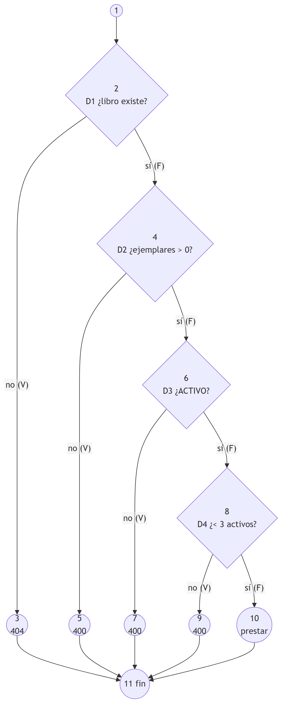
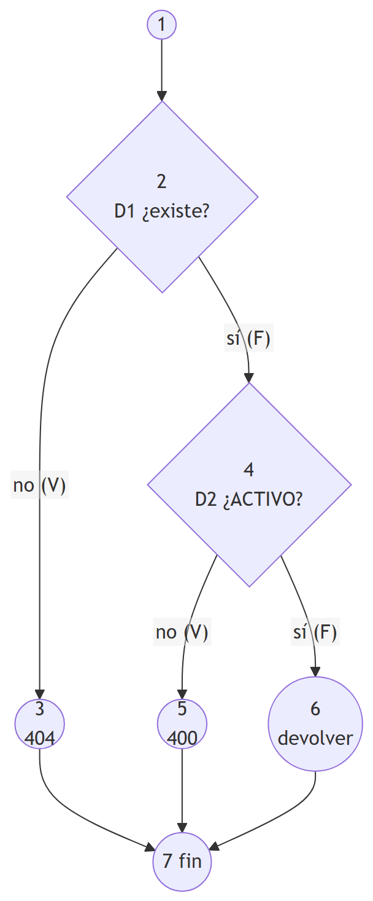
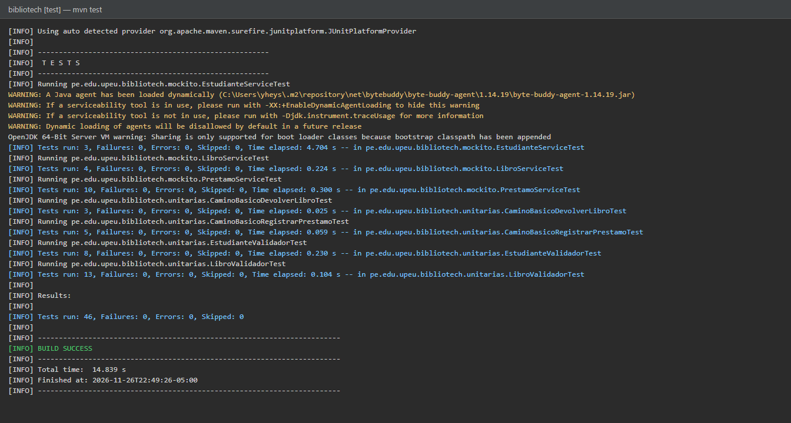
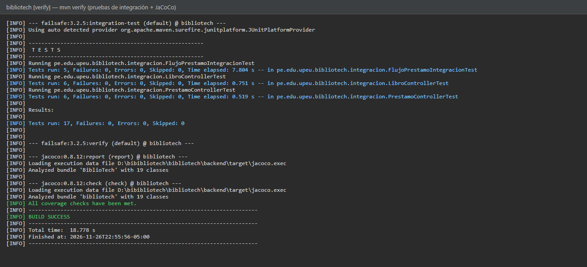
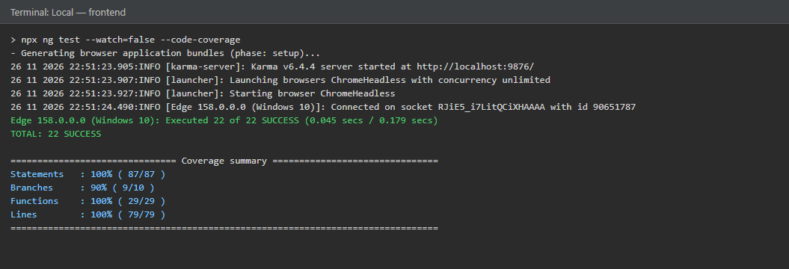
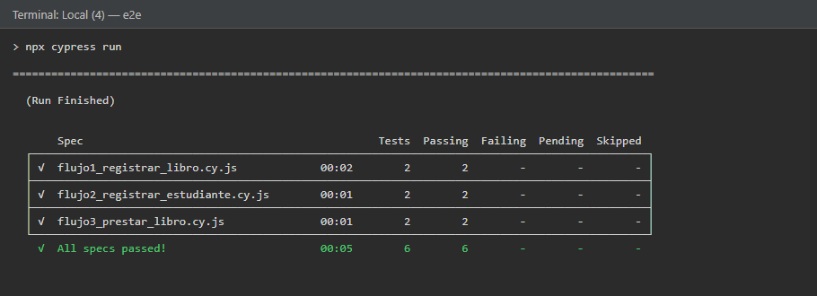
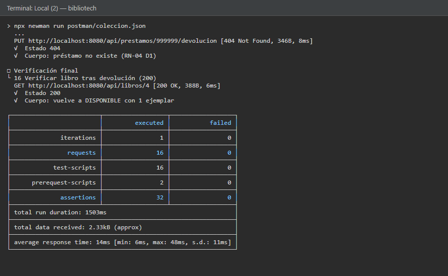
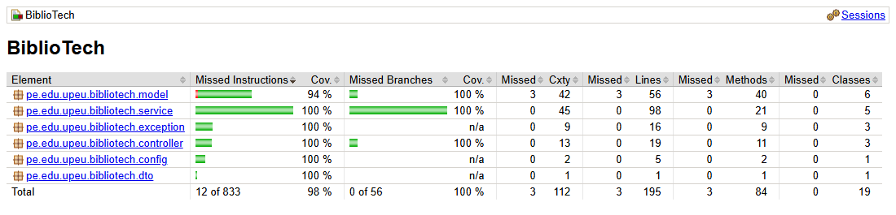
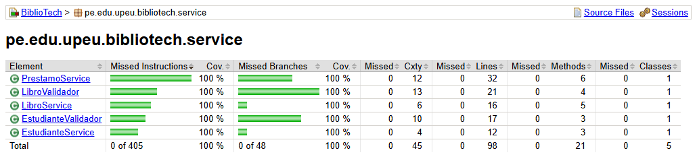

# Informe · Producto Académico U1 · Estrategia integral de pruebas · BiblioTech

> Borrador para el PDF (máx. 8 páginas). Resultados y capturas ya actualizados con la ejecución del 26/11/2026. Falta completar lo marcado con ✏️.

**Universidad Peruana Unión · E.P. Ingeniería de Sistemas**
**Curso:** Gobierno de Tecnologías de Información
**Integrantes:** ✏️
**Repositorio:** https://github.com/yheysonxdxd/bibliotech-u1

---

## 1. Estrategia de pruebas · pirámide de BiblioTech

```
                 ▲   E2E Cypress ............. 6 pruebas (3 flujos)
                ▲▲▲  API Postman/Newman ...... 16 requests · 32 aserciones
               ▲▲▲▲▲ Angular (TestBed/HTTP) .. 22 pruebas
              ▲▲▲▲▲▲▲ Integración Spring ..... 17 (12 @WebMvcTest + 5 @SpringBootTest)
            ▲▲▲▲▲▲▲▲▲▲ Mockito ............... 17 pruebas
          ▲▲▲▲▲▲▲▲▲▲▲▲▲▲ Unitarias JUnit 5 ... 25 métodos (29 ejecuciones con parametrizadas)
```

**Por qué esta distribución:**

- **Base ancha (unitarias + Mockito, 42):** las reglas RN-01 a RN-04 viven en `LibroValidador`, `EstudianteValidador` y `PrestamoService`. Son rápidas (milisegundos), no necesitan base de datos y señalan el punto exacto del fallo. Por eso concentran casi la mitad de las pruebas.
- **Medio (integración, 17):** comprueban lo que los mocks no pueden: el mapeo JPA, las restricciones `unique` de ISBN y DNI, la serialización JSON y los códigos HTTP (200/201/400/404). Son más lentas porque levantan el contexto de Spring, así que solo cubren los flujos clave.
- **Frontend (22):** validan el formulario y el uso correcto de la API con `HttpTestingController`, sin backend real.
- **Cima (E2E + API, 6 flujos + 16 requests):** pocas, porque son las más lentas y frágiles. Confirman que el sistema completo funciona de punta a punta.

## 2. Método del camino básico

Ver `docs/camino-basico.md` (código numerado, grafos, V(G) por tres fórmulas y tabla de casos).

| Método | Decisiones | V(G) | Caminos | Pruebas JUnit |
|---|---|---|---|---|
| `registrarPrestamo()` | D1 libro existe, D2 ejemplares > 0, D3 ACTIVO, D4 < 3 activos | 5 | 5 | `CaminoBasicoRegistrarPrestamoTest` (5) |
| `devolverLibro()` | D1 préstamo existe, D2 está ACTIVO | 3 | 3 | `CaminoBasicoDevolverLibroTest` (3) |

<table><tr>
<td align="center"><b>Grafo de flujo de <code>registrarPrestamo()</code></b> · V(G) = 5<br></td>
<td align="center"><b>Grafo de flujo de <code>devolverLibro()</code></b> · V(G) = 3<br></td>
</tr></table>

## 3. Resultados por nivel

| Nivel | Herramienta | Cantidad | Mínimo | Resultado | Evidencia |
|---|---|---|---|---|---|
| Unitarias | JUnit 5 (AAA) | 17 métodos (CP01–CP06 y más), 21 ejecuciones | 5 | Verde: 21/21, 0 fallos | `capturas/01-mvn-test.png` |
| Camino básico | JUnit 5 | 8 (5 + 3) | 2 métodos | Verde: 8/8, 0 fallos | `capturas/01-mvn-test.png` |
| Mockito | @Mock, @InjectMocks, verify, never() | 17 | 4 | Verde: 17/17, 0 fallos | `capturas/01-mvn-test.png` |
| Cobertura | JaCoCo | 98 % líneas (192/195) · 98 % instrucciones · 100 % ramas | 80 % | Cumple («All coverage checks have been met») | `capturas/02-jacoco.png` |
| Controlador | @WebMvcTest + MockMvc | 12 | 2 | Verde: 12/12, 0 fallos | `capturas/03-mvn-verify.png` |
| Integración | @SpringBootTest + H2 | 5 | 2 | Verde: 5/5, 0 fallos | `capturas/03-mvn-verify.png` |
| Angular | TestBed + HttpTestingController | 22 | 4 | Verde: 22/22 (100 % líneas, 90 % ramas) | `capturas/04-ng-test.png` |
| E2E | Cypress | 6 (3 flujos) | 2 | Verde: 6/6, 3 specs | `capturas/05-cypress.png` |
| API | Postman + Newman | 16 requests / 32 aserciones | 8 | Verde: 0 requests y 0 aserciones fallidas | `capturas/06-newman.png` |

**Totales:** `mvn test` ejecutó 46 pruebas y `mvn verify` añadió 17 de integración (63 en el backend, todas en verde, BUILD SUCCESS en ambos).

### Evidencias

**`mvn test`** (unitarias, camino básico y Mockito)



**`mvn verify`** (@WebMvcTest, @SpringBootTest y verificación de cobertura JaCoCo)



**`ng test --watch=false --code-coverage`** (Angular)



**`npx cypress run`** (E2E, con backend y frontend levantados)



**`newman run postman/coleccion.json`** (API, con el backend levantado)



## 4. Cobertura

Reporte generado por `mvn verify` en `backend/target/site/jacoco/index.html`.

**Vista por paquete:** 98 % de instrucciones, 100 % de ramas (56/56) y 192 de 195 líneas cubiertas (19 clases analizadas).



**Paquete `service`** (donde viven las reglas RN-01 a RN-04): 100 % de instrucciones y de ramas en las 5 clases.



| Paquete | Instrucciones | Ramas |
|---|---|---|
| `service` | 100 % | 100 % |
| `controller` | 100 % | 100 % |
| `exception` | 100 % | n/a |
| `config` | 100 % | n/a |
| `dto` | 100 % | n/a |
| `model` | 94 % | 100 % |

- **Clase con menor cobertura:** `model.Prestamo`, con las únicas 3 líneas sin cubrir del proyecto: `setFechaPrestamo()`, `setEstudiante()` y `setLibro()`. El préstamo se crea con su constructor y esos setters solo los usaría JPA o Jackson, así que no tienen lógica que probar.
- **Qué hicimos para mejorarla:**
  - En la primera medición (97 % de líneas, 98 % de ramas), `controller` quedaba en 88 % de instrucciones y 75 % de ramas: nadie llamaba a `GET /api/estudiantes` ni a `GET /api/prestamos`, y en `POST /api/prestamos` solo se probaba la falta de `libroId`, no la de `estudianteId`. Agregamos tres pruebas en `PrestamoControllerTest` (`listarPrestamos_200`, `listarEstudiantes_200` y `registrar_sinEstudianteId_400`) y el paquete subió al 100 %.
  - Agregamos casos de borde al validador (libro nulo, ejemplares nulos, libro vacío con todos los errores).
  - Cubrimos las ramas de error del controlador: JSON malformado → 400 y `GET /api/libros/{id}` → 404.
  - Excluimos del cálculo `BibliotechApplication` y `DatosIniciales`, que no tienen lógica de negocio.
  - El `pom.xml` hace fallar `mvn verify` si la cobertura de líneas baja del 80 %.

## 5. Hallazgos (defectos o riesgos detectados)

✏️ Cambien estos ejemplos por lo que les pasó de verdad al correr las pruebas.

| # | Hallazgo | Prueba que lo evidencia | Corrección |
|---|---|---|---|
| H1 | Un ISBN con espacios (`" 978…"`) pasaba la verificación de unicidad y generaba duplicados. | `LibroServiceTest.registrar_exitoso` | Se aplica `trim()` al ISBN antes de `existsByIsbn()` y de guardarlo. |
| H2 | El cliente podía registrar un estudiante enviando `"estado":"INACTIVO"`, lo que viola RN-02. | `EstudianteServiceTest.registrar_quedaActivo` | El servicio fuerza el estado `ACTIVO` al registrar. |
| H3 | En Angular, `Validators.required` aceptaba un título de solo espacios. | `libros.component.spec.ts` «título y autor con solo espacios» | Se añadió `Validators.pattern(/\S+/)`. |
| H4 | Devolver dos veces el mismo préstamo sumaba un ejemplar de más. | `FlujoPrestamoIntegracionTest.prestarYDevolver`, Newman #14 | Se agregó la decisión D2 (¿está ACTIVO?) en `devolverLibro()`. |
